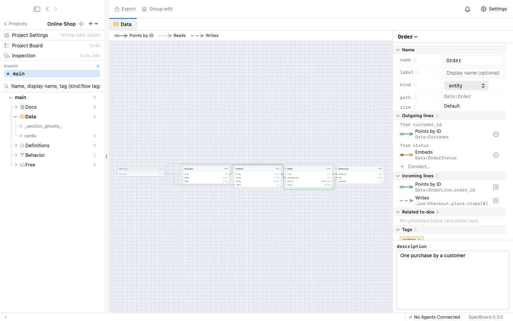
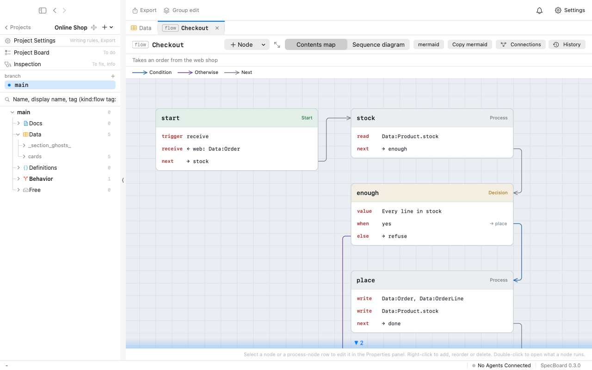

# SpecBoard

[English](README.md)

SpecBoard は、スキーマファーストで AI と一緒に開発するための macOS のアプリです。プロジェクトはカードを並べたボードで、
データの形（entity・enum・value）とシステムの振る舞い（flow・文書）を持ち、人と AI エージェントが同じものを読み書きする
正本になります。

- **人**は、カードと線のキャンバスで見て、確かめ、レビューします。
- **AI エージェント**は、MCP で同じプロジェクトを読み書きします。変更を branch で計画し、影響を調べ、実装しながら仕様を読みます。
- **型・図・文書はプロジェクトから作ります**（TypeScript・Zod・JSON Schema・Mermaid・Markdown）。手で描かないので、差分が取れ、
  検査できます。

コードとアプリのアイコンは、ほぼ全てを AI（Claude と Codex）が作り、メンテナが指示して確かめています。

<picture>
  <source media="(prefers-color-scheme: dark)" srcset=".github/assets/data-dark.png">
  
</picture>

<picture>
  <source media="(prefers-color-scheme: dark)" srcset=".github/assets/flow-dark.png">
  
</picture>

## 入れ方

[Releases](https://github.com/abratan-a/SpecBoard/releases/latest) から最新の `SpecBoard-<版>.dmg` を落とし、開いて
SpecBoard をアプリケーションへ入れます。アプリは Developer ID で署名して公証してあり、このリポジトリの Releases から
自分で更新します。

動く環境: Apple シリコンの Mac、macOS 26.5 以上。

## AI エージェントから使う（MCP）

MCP に答えるのはアプリの窓ではなく、**エージェント**（`specboard-agent`）です。AI に読ませるプロジェクトはエージェントに
置きます。

1. アプリで、AI のセッションが動くホスト（Apple シリコンの macOS か、x86_64 の Linux。SSH で繋ぐ）を足します。アプリが
   そこへエージェントを入れて起こします。
2. そのホストにプロジェクトを作るか、移します。
3. アプリの設定でアクセスキーを作り、読ませる・書かせるプロジェクトを選びます。
4. アプリが出すコマンドをコピーし、そのホストで流します。Claude Code なら次の形です。

   ```
   claude mcp add --transport http --scope user specboard http://127.0.0.1:8787/mcp --header "Authorization: Bearer <キー>"
   ```

エージェントはホストの `127.0.0.1` だけで待ち受け（既定のポートは 8787）、キーの無い要求を断ります。ほかのツールの
使い方は、ツール `guide` がエージェントに説明します。

## ソースから組む

要るもの:

- Apple シリコンの Mac、macOS 26.5 以上
- Xcode 26.5 以上
- [rustup](https://rustup.rs) で入れた Rust（版は `rust-toolchain.toml` で決まり、最初のビルドで入ります）
- 任意: [zig](https://ziglang.org) と [cargo-zigbuild](https://github.com/rust-cross/cargo-zigbuild)
  （`brew install zig cargo-zigbuild`）。Linux 用のエージェントを組むのに使います。無ければ Linux 用を入れずに組み、
  そのアプリは Linux のホストにエージェントを入れられません。

```
git clone https://github.com/abratan-a/SpecBoard.git
cd SpecBoard
xcodebuild -project sources/SpecBoard.xcodeproj -scheme SpecBoard -configuration Release \
  -destination 'platform=macOS' -derivedDataPath build build
open build/Build/Products/Release/SpecBoard.app
```

Xcode で `sources/SpecBoard.xcodeproj` を開き、スキーム `SpecBoard` を実行しても組めます。

組んだアプリの署名は「Sign to Run Locally」（チーム無し）です。自分のチームで署名するときは、`DEVELOPMENT_TEAM` と
`CODE_SIGN_IDENTITY` を `sources/Config/Signing.local.xcconfig` に書きます（`sources/Config/Signing.xcconfig` を参照）。
自分で組んだアプリは自分では更新しません（更新は、動いているアプリと同じチームの署名のものだけを受け付けます）。

コア（Rust）とそのテスト:

```
cd sources/core
cargo test --workspace
```

`tools/` には、Xcode のビルドが流す道具（`build-core-lib.sh`・`build-agent.sh`）、コアの Swift の口を作り直す道具
（`build-core-swift.sh`。`swift-check.sh` が確かめる）、サードパーティのライセンスの表示を集める道具（`notices.py`）があります。
`tools/build-dmg.sh` と `tools/publish-github.sh` はメンテナが署名・公証して出すための道具で、使わなくて大丈夫です。

コードの注釈は設計の文書を `specboard://SpecBoard/Docs/Design:<名前>` で指します。メンテナの公開していない設計の文書なので、設計の話題の名前として読んでください。

## 意見・不具合の知らせ

issue を英語でも日本語でも受け付けます。プルリクエストは受け付けていません。[CONTRIBUTING.md](CONTRIBUTING.md) を
見てください。脆弱性の知らせ方は [SECURITY.md](SECURITY.md) にあります。

## ライセンス

SpecBoard は、次のどちらかを選んで使えます。

- Apache License, Version 2.0（[LICENSE-APACHE](LICENSE-APACHE)）
- MIT license（[LICENSE-MIT](LICENSE-MIT)）

UniFFI の雛形から来た部分（MPL-2.0）と、サードパーティのライセンスの表示の場所は [NOTICE](NOTICE) にあります。

名前「SpecBoard」とアプリのアイコンは、これらのライセンスの対象外です。手を加えたものを配るときは、別の名前と
アイコンにしてください。

明示しない限り、あなたが取り込まれることを意図して送った貢献（Apache-2.0 の定義による）は、追加の条件なしに上の
2 つのライセンスのもとで扱います。
